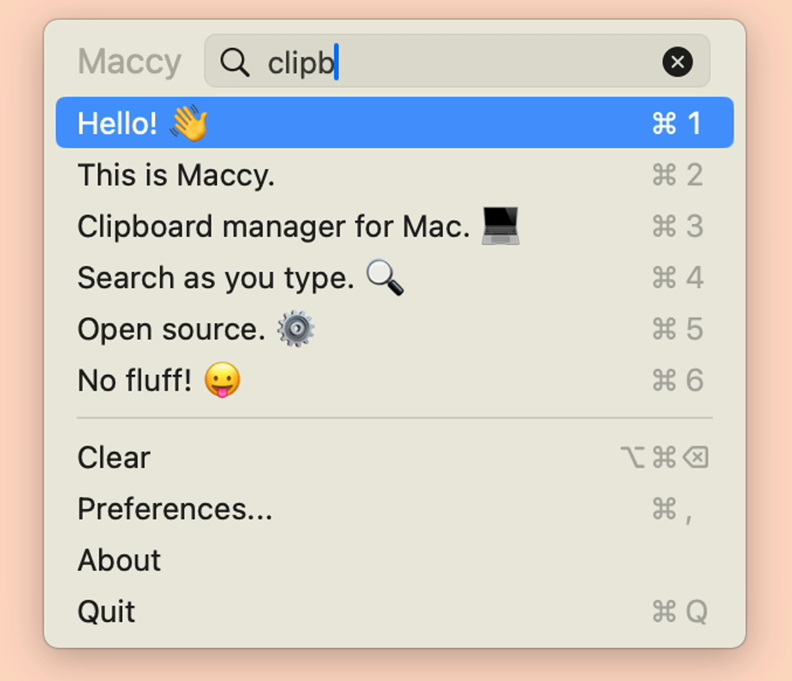

<p align="center">
  
  <h1 align="center">Maccy Blue</h1>
  <p align="center"><strong>Fast, lightweight, native macOS clipboard manager.</strong></p>
  <p align="center">
    
    
    
    
    
    <a href="https://github.com/p0deje/Maccy"></a>
  </p>
</p>

<p align="center">
  
</p>

## Overview

**Maccy Blue** is an optimized fork of [Maccy](https://maccy.app) focused on bulletproof clipboard image compatibility, zero-allocation memory management, and clean modern aesthetics.

---

## What Makes Maccy Blue Different

### 1. Reliable Image Pasting
- **Dual Synthesis (`public.png` + `public.tiff`)**: When copying older images back to the system pasteboard, both Cocoa-native (Pages, Keynote, Preview) and Electron/Chromium (Slack, Discord, VS Code) formats are synthesized.
- **Metadata Preservation**: Items containing mixed text/OCR metadata keep their underlying image binary when formatting is stripped.

### 2. Aggressive Memory Optimization
- **Zero-Allocation Type Checks**: Scans pasteboard type descriptors instead of decoding full `NSImage` bitmaps during list rendering and search.
- **Header-Only Dimensions**: Parses pixel dimensions via ImageIO metadata (`CGImageSourceCopyPropertiesAtIndex`) without allocating decoded bitmap buffers.
- **External Storage**: Offloads large image payloads via SwiftData `@Attribute(.externalStorage)` to prevent SQLite row cache bloat.
- **Eviction on Close**: Triggers `cleanupImages()` when the popup dismisses to flush decoded thumbnails from RAM.

### 3. Native Blue Identity
- **Feather Emblem App Icon**: Uses the iconic menu bar quill/feather emblem on an Apple royal blue squircle across all 10 resolutions (16px to 1024px).
- **Status Bar Theme**: Added `.maccyBlue` native menu bar icon.

---

## Keyboard Shortcuts

| Shortcut | Action |
|:---|:---|
| <kbd>⇧</kbd> + <kbd>⌘</kbd> + <kbd>C</kbd> | Toggle Maccy Blue popup |
| <kbd>Enter</kbd> / Click | Copy item to clipboard |
| <kbd>⌥</kbd> + <kbd>Enter</kbd> / <kbd>⌥</kbd> + Click | Paste item immediately |
| <kbd>⌥</kbd> + <kbd>⇧</kbd> + <kbd>Enter</kbd> | Paste item without formatting |
| <kbd>⌥</kbd> + <kbd>P</kbd> | Pin / unpin item to top |
| <kbd>⌥</kbd> + <kbd>⌫</kbd> | Delete selected item |
| <kbd>⌥</kbd> + <kbd>⌘</kbd> + <kbd>⌫</kbd> | Clear unpinned history |
| <kbd>⌘</kbd> + <kbd>,</kbd> | Preferences |

---

## Build & Install

### Requirements
- macOS 14.0 (Sonoma) or higher
- Xcode 16+ / Swift 6.0

### Build from Source
```sh
git clone https://github.com/sanad-source/Maccy-Blue.git
cd Maccy-Blue
xcodebuild -scheme Maccy -configuration Release clean build
```

---

## License

[MIT](./LICENSE)
